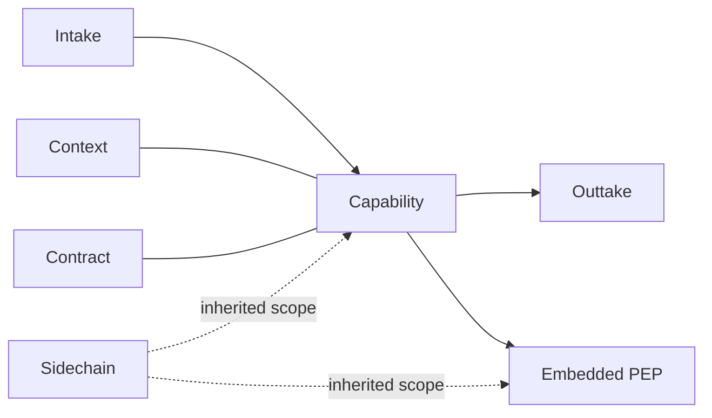

# ic3o

Intake · Context · Contract · Capability · Outtake

**Developer preview v0.9.0** | Apache-2.0 | Node.js 22.13+

ic3o is an open-source framework for building recursively composed, contract-governed applications. A capability can be another pipeline with the same interface. Applications can reuse functional libraries called Modes without committing to a specific intelligence provider.

## Quick start

```sh
npm install
npm test
npm link
ic inspect projects/order
ic run projects/order requested=8 available=5 unit_price=250
ic test projects/order
npm start
```

Open http://127.0.0.1:8799. The local demo is unauthenticated; do not expose it to untrusted networks. If `ic` conflicts with another executable, use `ic3o` instead or `node cli.mjs` without linking. The package is deliberately marked private to prevent accidental npm publication during the developer preview.

## The architectural pattern

| Responsibility | Purpose |
|---|---|
| Intake | Entry point and typed inputs |
| Context | Meaning, relationships and state |
| Contract | Executable requirements and guarantees |
| Capability | Replaceable implementation or embedded PEP |
| Outtake | Typed results |



The four native file types are `.pep`, `.context`, `.contract` and `.capability`. The project directory convention is optional: matching names resolve automatically, and explicit paths override default associations.

```text
projects/order/
  pep/order.pep
  pep/allocation.pep
  context/order.context
  contract/order.contract
  contract/allocation.contract
  frontend/order/
  fixtures.json
```

Example (`projects/order/pep/order.pep`):

```text
Order allocation

Intake
    source: POST /api/run
    requested: integer
    available: integer
    unit_price: integer

Capability
    allocation = allocation.pep(requested, available)
    total = multiply.capability(allocation, unit_price)
    remaining = subtract.capability(available, allocation)

Outtake
    allocation: integer
    total: integer
    remaining: integer
```

Outtake declares typed results only. There is no routing syntax. Delivery to the outside world is a capability whose `.capability` file declares `effect: true` under `Implementation`. An effect is deferred until the network has settled and its Guarantees pass, so transient intermediate values are never judged and nothing leaves a network that fails its contract. Effects cannot feed other steps or appear in Outtake, and they fail closed unless the trusted host supplies a `deliver` binding.

The matching context and contract resolve by convention. `allocation.pep` is an embedded pipeline; it can have its own context, contract and frontend. Modes distribute reusable artifacts. Sidechains are PEP references inherited by descendants.

## Commands available today

`ic inspect`, `ic validate`, `ic resolve`, `ic run`, `ic test`, `ic modes`, `ic frontends`. Commands accepting a PEP also accept conventional project directories. `ic init`, package installation and remote Mode distribution are future work.

## Examples and experiments

- `projects/order`: recursive execution, contracts and frontends.
- `projects/mode-order`: reusable Mode imports.
- `projects/sidechain-demo`: inherited sidechains and execution evidence (`npm run sidechain:demo`).
- `projects/social`: experimental schema-addressed storage and revision provenance (`npm run storage:demo`, `npm run storage:bench`).

Read [implementation notes](docs/implementation-notes.md), [effects](docs/EFFECTS.md), [sidechains](docs/SIDECHAINS.md), [storage](docs/STORAGE-EXPERIMENT.md) and [provenance](docs/PROVENANCE.md). Legacy internal SDK identifiers and environment variables are retained for compatibility.

## Status and safety

The native grammar and API are unstable. The prototype has no production authentication, sandboxing, external integration adapters or general-purpose arbitrary capability execution. Treat all definitions and Modes as trusted local code. Storage and provenance experiments are not integrated with ordinary PEP transactions. Journal commitments are not independently authenticated. No delivery adapters are bundled; effects need a host-supplied `deliver` binding. No AI service is required or bundled. Proprietary intelligence implementations and commercial hosted products are outside this repository.

## Contributing

See [CONTRIBUTING.md](CONTRIBUTING.md), [GOVERNANCE.md](GOVERNANCE.md), [CODE_OF_CONDUCT.md](CODE_OF_CONDUCT.md) and [SECURITY.md](SECURITY.md). Contributions should preserve observable contracts and include reproducible tests.
